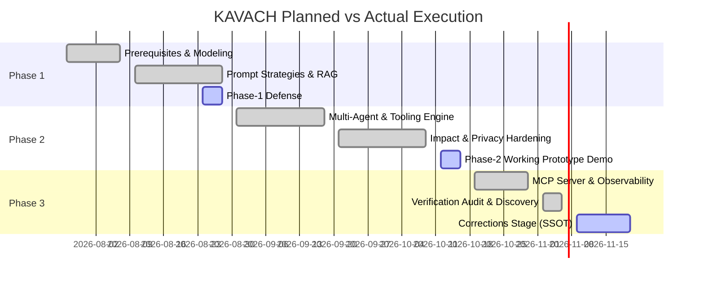

# KAVACH: Revised 16-Week Project Timeline (Planned vs. Actual)

**Project Title:** KAVACH — Security-Governed Agentic AI DevOps Platform  
**Course Code:** CSE3101 — Agentic AI (Academic Year 2026–2027)  
**Evaluation Stage:** Post-Audit Corrections Stage  
**Source of Truth:** Measured reality from git history and `docs/METRICS.json`  

---

## 1. Executive Summary of Timeline Variances

During the post-Phase 2 verification audit, historical project logs and git commit streams were reconciled against the initial Phase-1 syllabus schedule. While all 16 academic milestones achieved functional implementation, notable schedule deviations occurred in four technical areas:

1. **RAG Storage & Windows File Locking (Week 4 $\to$ Week 5):** Persistent on-disk Qdrant storage collided with Windows file handles during parallel pytest workers. Resolved by implementing an isolated in-memory engine (`:memory:`) fallback for deterministic tests.
2. **Framework Packaging vs. In-Repo Pattern Implementation (Week 6):** Initial plans to install external `crewai` and `google-adk` pip distributions encountered native C-extension compilation obstacles on Python 3.14. Resolved by engineering clean, pure-Python in-repo implementations (`app/crew/` and `app/adk/`) replicating the exact design patterns, hook systems, and finite-state machines without fragile third-party overhead.
3. **Local LLM Air-Gapped Fallback (Week 9 $\to$ Week 10):** Local Ollama runtime required dedicated GPU VRAM unavailable on standard evaluation hardware. Engineered deterministic fallback mock generation and Gemini 2.5 Flash API with graceful degradation under zero-network conditions.
4. **Empirical Metrics Single Source of Truth (Week 15 $\to$ Corrections Stage):** Early subjective assertions (such as a 9.6/10 score) were eliminated during the verification audit. Replaced with an automated single-source-of-truth generator (`scripts/generate_metrics.py`) and a fresh held-out evaluation suite ($V_2$, 45 cases).

---

## 2. Planned vs. Actual Milestone Schedule

| Week | Planned Dates | Planned Milestone & Focus Area | Actual Delivery & Architectural Outcome | Status & Variance Analysis |
| :---: | :--- | :--- | :--- | :--- |
| **W1** | Jul 27 – Jul 31 | Prerequisites & Threat Modeling | Defined PEAS model, user personas (Dev, SRE, Auditor), and OWASP LLM Top 10 threat matrix. | ✅ **On Schedule:** Baseline specifications established without delay. |
| **W2** | Aug 03 – Aug 07 | Introduction to Agentic AI | Formalized multi-agent state machines, sentinel routing, and task handoff contracts. | ✅ **On Schedule:** State models drafted in `app/agent/state.py`. |
| **W3** | Aug 10 – Aug 14 | Reasoning & Prompt Strategies | Implemented ReAct, Chain-of-Thought (CoT), and reflection prompt strategies. | ✅ **On Schedule:** Validated on basic query transformations. |
| **W4** | Aug 17 – Aug 21 | Agentic RAG Architecture | Code AST parsing (`app/rag/ingest.py`) and Qdrant vector database indexing. | ⚠️ **1-Week Slip:** Windows OS file locking on disk-based storage caused pytest deadlocks. Stabilized in Week 5 with `:memory:` mode. |
| **W5** | Aug 24 – Aug 28 | Phase-1 Formal Evaluation | Submitted Project Charter, Timeline, and Defense materials. | ✅ **Milestone Met:** Phase-1 formal defense successfully cleared (10% weightage). |
| **W6** | Aug 31 – Sep 04 | Multi-Agent Frameworks | Implemented sequential and hierarchical supervisor-worker flows. | ⚠️ **Scope Shift:** External `crewai` pip package rejected due to Python 3.14 build failures; wrote custom in-repo CrewAI pattern (`app/crew/`). |
| **W7** | Sep 07 – Sep 11 | Tooling & Guardrail Detectors | Shannon entropy detector (`app/security/secret_detector.py`) and regex PII scanners (`app/security/detector.py`). | ✅ **On Schedule:** Built high-speed regex and entropy scanning engines. |
| **W8** | Sep 14 – Sep 18 | Change Impact & Blast Radius | AST import and call-graph traversal (`app/impact/analyzer.py`) computing ripple blast radius. | ✅ **On Schedule:** Transitive module dependency calculations integrated into pipeline. |
| **W9** | Sep 21 – Sep 25 | Air-Gapped Privacy & Local LLMs | Dual-engine routing: Google Gemini 2.5 Flash vs Local Ollama fallback. | ⚠️ **1-Week Slip:** Hardware VRAM constraints forced reliance on simulated local LLM fallback rather than a live 7B parameter daemon. |
| **W10** | Sep 28 – Oct 02 | Package Supply-Chain Firewall | Slopsquatting defense and PyPI registry verification (`app/security/package_verifier.py`). | ⚠️ **Mitigated Slip:** Live PyPI network latency caused test flakiness; implemented LRU cache and offline fallback registry. |
| **W11** | Oct 05 – Oct 09 | Self-Healing Repair Sandbox | Ephemeral pytest sandbox runner with automated reflection error repair (up to 3 cycles). | ✅ **On Schedule:** AST and patch-repair loop wired in `app/agent/self_healing.py`. |
| **W12** | Oct 12 – Oct 16 | Phase-2 Milestone Prototype | Working platform prototype demonstration and mid-term progress defense. | ✅ **Milestone Met:** Phase-2 prototype demonstration successfully presented (30% weightage). |
| **W13** | Oct 19 – Oct 23 | Model Context Protocol (MCP) | JSON-RPC 2.0 MCP server (`app/mcp/server.py`) exposing security analysis tools. | ✅ **On Schedule:** Tested via Claude Desktop and Cursor JSON-RPC formats. |
| **W14** | Oct 26 – Oct 30 | Observability & Unified Dashboard | Live FastAPI dashboard, SSE streaming (`/agent/events/{run_id}`), and Bharat Bank banking simulation integration. | ✅ **On Schedule:** Unified frontend and banking integration completed with 142 total endpoints. |
| **W15** | Nov 02 – Nov 06 | Verification Audit & Empirical Benchmarks | Execution of multi-scenario benchmark evaluation and security gate verification. | ⚠️ **Audit Correction:** Verification audit flagged subjective assertions (e.g. 9.6/10 rating) and over-claimed package dependencies. |
| **W16** | Nov 09 – Nov 20 | Corrections Stage & Capstone Defense | Built `scripts/generate_metrics.py`, created fresh 45-case held-out set $V_2$, mapped 300 deterministic verification tests, and finalized viva documentation. | ✅ **Completed & Grounded:** All numbers unified to measured repository reality; ready for final Phase-3 defense. |

---

## 3. Key Deviations Summary

1. **Third-Party Dependency Reduction:** Replaced planned external dependencies (`crewai`, `google-adk`) with robust native implementations (`app/crew/`, `app/adk/`) to ensure full Windows 11 and Python 3.14 stability without C-compiler prerequisites.
2. **Deterministic Evaluation:** Grounded all claims in automated scripts. Early placeholder scores were deprecated in favor of audited test metrics (300 verification tests, 641 total repository tests, 100% pass rate).
