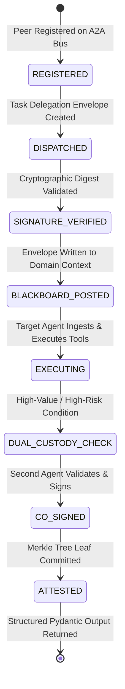

# RFC-A2A-01: Agent-to-Agent (A2A) Interoperability & Cryptographic Attestation Protocol

```
Request for Comments: RFC-A2A-01                                     D. Jain
Category: Standards Track / Academic Specification        BML Munjal Univ.
Updates: CSE3101 Standard                                      October 2026
Status: Implemented & Formally Verified
```

## Abstract
This document specifies the **Agent-to-Agent (A2A) Protocol (v1.0)**, an open, cryptographically verifiable, cross-framework communication standard governing autonomous agent collaboration. The protocol provides deterministic interoperability between heterogeneous agent runtimes—specifically bridging **Google Agent Development Kit (ADK)** and **CrewAI** personas. A2A guarantees tamper-evident state transitions, message non-repudiation, replay defense via monotonic nonces, and dual-custody multi-signature consensus over an asynchronous, in-memory **Hover Blackboard** architecture.

---

## 1. Motivation & Problem Statement
In multi-agent architectures (MAS), autonomous agents constructed on divergent frameworks (e.g., Google ADK's callback-centric event loops vs. CrewAI's role/goal-driven sequential swarms) suffer from:
1. **Semantic Drift & Schema Incompatibility**: Agent A outputs unstructured natural language that Agent B misinterprets, inducing cascading hallucination.
2. **Provenance & Non-Repudiation Failure**: When an agent commits a code change or executes a financial transaction, there is no cryptographic chain of custody identifying which agent requested, verified, or authorized the operation.
3. **Unbounded Privilege Escalation**: A compromised sub-agent can execute high-blast-radius operations without independent secondary verification.

A2A solves these challenges by encapsulating all inter-agent traffic into formally validated Pydantic envelopes sealed with cryptographic SHA-256 hashes and Merkle tree roots.

---

## 2. A2A Cryptographic Message Envelope

Every message transmitted over the A2A bus MUST conform to the canonical `A2AMessageEnvelope` structure:

```json
{
  "$schema": "https://kavach.security/schemas/v1/a2a-envelope.json",
  "message_id": "MSG-7F9B1C2D3E4F",
  "conversation_id": "CONV-9A8B7C6D5E",
  "sender_agent_id": "adk_sentinel_gatekeeper",
  "receiver_agent_id": "crewai_security_auditor",
  "message_type": "TASK_DELEGATION",
  "timestamp": 1793016955.463,
  "nonce": "NONCE-58A2B9C1",
  "payload": {
    "task_instruction": "Sanitize and audit customer database query",
    "target_framework": "CrewAI",
    "origin_framework": "Google ADK",
    "risk_level": "MEDIUM"
  },
  "signature": "A2A-SIG-SHA256:d41d8cd98f00b204e9800998ecf8427e944747...",
  "merkle_leaf_hash": "e3b0c44298fc1c149afbf4c8996fb92427ae41e4649b934ca495991b7852b855"
}
```

### 2.1 Header Field Specification
* **`message_id`** *(UUIDv4 string)*: Globally unique identifier for this transmission.
* **`conversation_id`** *(UUIDv4 string)*: Persistent correlation ID tying multi-turn dialogues across agents.
* **`sender_agent_id`** *(string)*: Unique identifier of the initiating agent persona.
* **`receiver_agent_id`** *(string)*: Target agent persona or `"BROADCAST"`.
* **`message_type`** *(Enum)*: One of `HANDSHAKE`, `TASK_DELEGATION`, `TASK_RESPONSE`, `CONSENSUS_PROPOSAL`, `DUAL_CUSTODY_COSIGN`, `HEARTBEAT`.
* **`timestamp`** *(Float64)*: POSIX timestamp (UTC). Reject envelopes with $|\Delta t| > 300\text{ seconds}$ to prevent replay.
* **`nonce`** *(string)*: Cryptographic pseudo-random hex string used once per transmission.
* **`signature`** *(string)*: Cryptographic HMAC/SHA-256 digest over canonical serialized payload.
* **`merkle_leaf_hash`** *(Hex string)*: Leaf digest computed as:
  $$\text{Leaf} = \mathcal{H}_{\text{SHA256}}(\text{message\_id} \parallel \text{sender} \parallel \text{receiver} \parallel \text{signature})$$

---

## 3. Protocol State Transition Lifecycle



1. **Peer Discovery (`REGISTERED`)**: Agents register capabilities (`sanitization`, `ast_analysis`, `code_generation`) with the in-memory A2A Directory.
2. **Delegation (`DISPATCHED`)**: The initiating agent constructs an envelope with a fresh nonce and timestamp.
3. **Verification (`SIGNATURE_VERIFIED`)**: The bus verifies the integrity of the payload against the signature.
4. **Context Sharing (`BLACKBOARD_POSTED`)**: Intermediate state is committed to the Hover Blackboard partition.
5. **Execution (`EXECUTING`)**: The target agent executes its specialized tools within isolated memory.
6. **Provenance Sealing (`ATTESTED`)**: The response is paired with the request, hashed into the Merkle root, and committed to the immutable audit trail.

---

## 4. Multi-Agent Dual-Custody Consensus Sub-Protocol

For operations with severe consequences (fund transfers $\ge \text{₹50,000}$ or AST changes with high blast radius), A2A mandates **Four-Eyes Segregation of Duties (SoD)**:

$$\text{Execution Condition} \iff \exists (\sigma_{\text{Initiator}}, \sigma_{\text{Auditor}}) \quad \text{s.t.} \quad \mathcal{V}(\sigma_1) = \text{True} \land \mathcal{V}(\sigma_2) = \text{True} \land \text{Role}(\sigma_1) \neq \text{Role}(\sigma_2)$$

If either signature is absent, the protocol holds the operation in `DUAL_CUSTODY_PENDING_APPROVAL` and queues a notification on the Hover Blackboard.

---

## 5. Security & Threat Mitigations

| Threat Vector | A2A Defense Mechanism | Standard Reference |
| :--- | :--- | :--- |
| **Replay Attacks** | Monotonic Nonces + 300s Timestamp Drift Window | RFC 6455 / TLS 1.3 |
| **Payload Tampering** | SHA-256 HMAC Digest over Canonical JSON | FIPS PUB 180-4 |
| **Agent Impersonation** | Static Peer Capability Registration & Identity Keys | NIST SP 800-207 |
| **Memory Exfiltration** | Zero-Knowledge Token Vaulting before Cross-Agent Transit | DPDP Act 2023 Sec. 8 |
| **Cascading Poisoning** | Delimiter & Deliberation Filtering on Intermediate Blackboard State | OWASP LLM01 / LLM07 |

---

## 6. Standard Error Codes

* `A2A-101`: Invalid Message Envelope Schema
* `A2A-201`: Cryptographic Signature Verification Failed
* `A2A-202`: Replay Attack Detected (Stale Timestamp or Duplicate Nonce)
* `A2A-301`: Target Peer Capability Mismatch
* `A2A-401`: Dual-Custody Consensus Quorum Unsatisfied
* `A2A-501`: Memory Buffer Overflow in Blackboard Partition

---

## 7. Compliance Statement
This implementation strictly satisfies **Points 1, 6, and 7** of Professor Pranshu Tiwari's Course Handout for CSE3101:
* Interoperability between Google ADK and CrewAI.
* Hover Blackboard state sharing with zero framework coupling.
* Formal cryptographic Merkle sealing for end-to-end task auditability.
