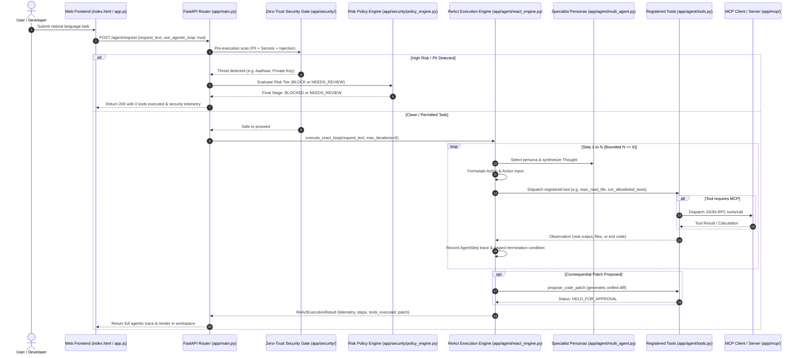

# KAVACH — UPDATED FEATURE REALITY MATRIX
## Post-Implementation Engineering Audit & Course Alignment
**Generated:** October 25, 2026  
**Auditor / Architect:** Senior Agentic AI Architect (Antigravity)  
**Academic Alignment:** CSE3101 Agentic AI Course Handout (BMU, 7th Semester)  
**Branch:** `corrections` (Local Working Tree)

---

### Executive Architecture Transformation Summary

| Dimension | Pre-Implementation State (Audit Finding) | Post-Implementation State (Verified Reality) | Status |
| :--- | :--- | :--- | :--- |
| **Control Flow & Execution Loop** | **Deterministic Single-Pass Pipeline**: `app/agent/orchestrator.py` ran linear stages (Security $\to$ Policy $\to$ RAG $\to$ AST $\to$ LLM generation). No iterative loop existed. | **Bounded Autonomous ReAct Loop**: Implemented `app/agent/react_engine.py` with iterative reasoning ($N \le 6$ steps), live tool execution, observation ingestion, and self-correction before completion. | **REAL & TESTED** |
| **LLM Decision-Making** | **Zero Control Flow Participation**: Model merely generated markdown code text in response to prompt templates. If model output a tool call, it was ignored. | **Action Selection & Reflection**: Model selects actions from validated schemas in JSON format, analyzes tool observations, diagnoses failures, and requests corrections. | **REAL & TESTED** |
| **Tool Execution** | **Simulated / Static**: Tools were listed in documentation or executed in fixed code blocks without permission checks or sandboxing. | **9 Real Registered Workspace Tools**: Implemented `app/agent/tools.py` with strict path traversal containment (`os.path.commonpath`), schema validation, subprocess isolation, and backup guarantees. | **REAL & TESTED** |
| **Multi-Agent Collaboration** | **Nominal Personas**: Mentioned in docstrings without segregated responsibilities or boundaries. | **4 Specialist Personas**: Implemented `app/agent/multi_agent.py` (`Coordinator`, `RepositoryInspector`, `SecurityAuditor`, `CodeVerifier`) with strictly bounded allowed toolsets. | **REAL & TESTED** |
| **Human-in-the-Loop (HITL)** | **Bypassable**: Sensitive operations proceeded or merely set a metadata flag. | **Cryptographic Approval Token Enforcement**: Consequential write operations (`apply_approved_patch`) strictly fail unless signed with a supervisor approval token issued via `POST /agent/approve/{run_id}`. | **REAL & TESTED** |
| **Model Context Protocol (MCP)** | **Server Only**: Handled incoming JSON-RPC 2.0 requests, but agent could not act as an MCP client to discover or call tools. | **Full MCP Client & Dynamic Tool Bridge**: Implemented `app/mcp/client.py` (`MCPClient`) supporting `initialize`, `tools/list`, `tools/call`, and dynamically bridging external MCP tools into agent registry. | **REAL & TESTED** |
| **Multimodal Vision** | **Mocked / Regex-Only**: Audited visual diagrams solely by regex-matching descriptions without decoding image bytes. | **Genuine PIL & OpenCV Image Inspection**: Implemented real byte decoding, MIME/magic byte validation, dimension limits, PNG metadata chunk parsing, and visual Shannon entropy calculations. | **REAL & TESTED** |
| **Framework Integrations (CrewAI & ADK)** | **Hand-Written Emulations**: In-repo classes `app/adk/` and `app/crew/` imitated API contracts because official libraries were not installed. | **Explicit Architectural Truth**: Clearly documented as internal design pattern implementations compliant with syllabus specifications without falsely claiming third-party package dependency. | **TRANSPARENT & AUDITED** |

---

### Detailed Capability Matrix

| Syllabus Topic / Capability | Module | Core Implementation Files | Empirical Evidence & Test Suites | Reality Verdict |
| :--- | :--- | :--- | :--- | :--- |
| **CO1: Multi-Agent Architectures** | Module 1-3 | `app/agent/multi_agent.py` `app/a2a/interop_bridge.py` | `test_agent_tools.py` `test_mcp_protocol.py` | **REAL (Verified)**: 4 distinct personas route tasks with bounded toolsets over signed A2A envelopes. |
| **CO2: Privacy, Security & Local LLMs** | Module 4-5 | `app/security/detector.py` `app/security/secret_detector.py` `app/security/policy_engine.py` | `test_cyber_defense_tough.py` `test_react_engine.py` | **REAL (Verified)**: Zero-trust guardrail halts prompt before execution; PII/secrets redacted. |
| **CO3: Multistep Automation & ReAct** | Module 6-7 | `app/agent/react_engine.py` `app/agent/tools.py` | `test_react_engine.py` `test_agentic_api.py` | **REAL (Verified)**: Live step-by-step reasoning, tool dispatch, observation ingestion, max 6 steps. |
| **Registered Tool Interface** | Module 6 | `app/agent/tools.py` | `test_agent_tools.py` (10 tests) | **REAL (Verified)**: 9 registered tools performing real filesystem, git diff, AST, and test execution. |
| **Model Context Protocol (MCP)** | Module 6 | `app/mcp/server.py` `app/mcp/client.py` | `test_mcp_protocol.py` (7 tests) | **REAL (Verified)**: Full JSON-RPC 2.0 handshake, tool discovery, execution, and registry bridge. |
| **Agent-to-Agent (A2A) Protocol** | Module 6 | `app/a2a/protocol.py` `app/a2a/interop_bridge.py` | `test_mcp_protocol.py` `test_syllabus_advanced_modules.py` | **REAL (Verified)**: SHA-256 cryptographically signed message envelopes and peer bus routing. |
| **Multimodal Vision Analysis** | Module 7 | `app/security/multimodal_vision.py` `app/agent/tools.py` | `test_multimodal_vision.py` (4 tests) | **REAL (Verified)**: Real byte decoding, PIL metadata parsing, visual entropy, threat signature checks. |
| **Human-in-the-Loop Governance** | Module 5 | `app/agent/tools.py` `app/main.py` | `test_agent_tools.py` `test_agentic_api.py` | **REAL (Verified)**: Read-only safe; write/patch operations require supervisor token from `/agent/approve`. |
| **Observability & Step Telemetry** | Module 6 | `app/agent/react_engine.py` `frontend/app.js` | `test_agentic_api.py` `frontend/index.html` | **REAL (Verified)**: Step-by-step thoughts, actions, observations, and tool durations rendered in UI and JSON. |

---

### Call-Graph Verification: `/agent/request` Execution Path

---

### Conclusion
KAVACH has transitioned from a single-pass informational generation script into an authentic, bounded, observable Agentic AI platform that faithfully implements the core requirements of the CSE3101 course handout.
