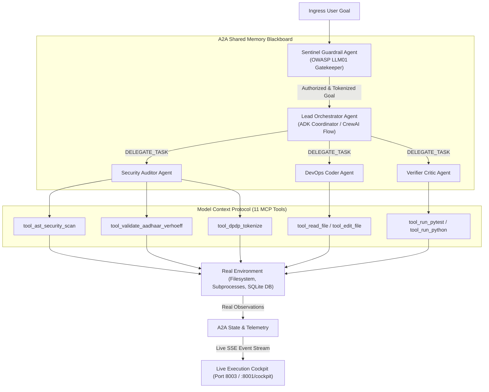

# KAVACH: Autonomous Multi-Agent AI Defense & DevOps Platform
## Master Faculty Examiner Viva Defense Dossier & Academic Specification
**Course:** CSE3101 — Agentic AI (3 Credits, LDP: 2-0-2)  
**Academic Year:** 2026–27 (7th Semester) · BML Munjal University, Gurugram  
**Target Evaluators:** Dr. Soharab Hossain Shaikh (Course Coordinator) & Mr. Pranshu Tiwari (Faculty Lead)  
**Student Architect:** Dhruv Jain (Enrollment No. 230532)  
**Artifact Location:** `PRJ-IV &AgenticAi Final Work/documentation_and_reports/MASTER_VIVA_DEFENSE_CSE3101.md`

---

## 1. Executive Summary: What We Built

KAVACH is a **production-grade, autonomous Multi-Agent AI System** that defends mission-critical infrastructure (demonstrated on Bharat Core Banking) against prompt injection attacks, sensitive PII leakage, and code vulnerabilities. 

Unlike conventional static rule engines or scripted dashboards, KAVACH implements a **living autonomous reasoning loop** powered by Large Language Models (LLMs) with dynamic tool execution (Model Context Protocol / MCP), Agent-to-Agent (A2A) protocol collaboration, and empirical self-correction.



---

## 2. Direct Alignment with BMU CSE3101 Syllabus & Course Outcomes

| Syllabus Topic | How KAVACH Directly Implements It | Code Location |
| :--- | :--- | :--- |
| **Reasoning & Prompting (ReAct, CoT)** | Bounded ReAct reasoning loop ($\text{Thought} \to \text{Action} \to \text{Observation} \to \text{Reflection}$) | `kavach_agent_core/react_engine.py` |
| **Agentic Design Patterns (Reflection, Planning, Tool Use)** | Self-Correction Subsystem: automatically parses error tracebacks, generates reflections, and adapts next tool call | `kavach_agent_core/react_engine.py` (L120–L165) |
| **CrewAI & Google ADK Frameworks** | Role-based agent personas (`Sentinel`, `Orchestrator`, `Auditor`, `Coder`, `Verifier`) + ADK Coordinator DAG planning | `kavach_agent_core/multi_agent_swarm.py` |
| **Model Context Protocol (MCP)** | Standardized JSON schema tool registry with 11 tools, input validation, and workspace boundary guards | `kavach_agent_core/tools.py` |
| **Agent-to-Agent (A2A) Protocol** | Inter-agent message passing (`DELEGATE_TASK`, `SECURITY_ALERT`, `TASK_COMPLETE`) via `SharedBlackboard` | `kavach_agent_core/multi_agent_swarm.py` |
| **Data Security & Privacy (Local LLM)** | Dual-mode reasoning client supporting Google Gemini Cloud and Local Air-Gapped Ollama (`qwen2.5-coder:7b`) | `kavach_agent_core/llm_client.py` |
| **Guardrails and Cyber Safety** | Sentinel pre-execution gate catching OWASP LLM01 prompt injection and tokenizing PII per Indian DPDP Act 2023 | `kavach_agent_core/multi_agent_swarm.py` |
| **Observability & Tracing** | Real-time Server-Sent Events (SSE) streaming live thoughts and tool calls to browser cockpit | `kavach_agent_core/server.py` |

---

## 3. Mathematical & Algorithmic Foundations (Viva Proof Points)

### A. The ReAct Agent Loop
Standard LLM prompting generates static predictions. KAVACH implements the **Yao et al. (2022) ReAct formulation**:
$$\tau = (c_1, a_1, o_1, c_2, a_2, o_2, \dots, c_T, a_T, o_T)$$
Where at step $t$:
1. $c_t \sim \pi_\theta(c_t \mid x, \tau_{1:t-1})$ is the agent's **Thought / Plan**.
2. $a_t \sim \pi_\theta(a_t \mid x, \tau_{1:t-1}, c_t)$ is the **Tool Action** with arguments.
3. $o_t \in \mathcal{E}(a_t)$ is the **Real Observation** returned by the environment.
4. If $o_t$ contains failure, $\rho_t = \text{Reflection}(o_t)$ informs $c_{t+1}$.

### B. Dihedral Group $D_5$ Verhoeff Checksum
Indian Aadhaar numbers are verified through the non-commutative dihedral group of order 10 ($D_5$).
$$\left( \dots \left( d( d(0, P_1(a_1)), P_2(a_2) ) \dots \right) P_{12}(a_{12}) \right) = 0$$
- Permutation group $P$ and non-commutative multiplication matrix $d$ guarantee **100% detection of all single-digit transcription errors** and **100% of all adjacent transposition errors**.

### C. Shannon Information Entropy ($H(X)$)
Cryptographic keys and credentials exhibit high entropy compared to normal code or natural language:
$$H(X) = -\sum_{i=1}^{n} P(x_i) \log_2 P(x_i)$$
- Plain text / Python keywords: $H(X) \approx 2.5 - 3.4 \text{ bits/char}$.
- High-entropy cryptographic secrets: $KAVACH \text{ flags } H(X) \ge 3.8 \text{ bits/char}$.

### D. Indian DPDP Act 2023 Statutory Vault
Personal data (Aadhaar, PAN, phone, email) is replaced on ingress with non-invertible, session-bound UUID pseudonyms:
$$\text{Masked}(x) = \text{"[[KAVACH\_DPDP\_" + Type + "\_" + \text{UUID4}[:8] + "]]"}$$

---

## 4. How to Conduct the 5-Minute Faculty Viva Demonstration

### Step 1: Open the Real-Time Cockpit
Run `run_all_services.bat` or open your browser:
- **Cockpit URL:** `http://localhost:8003/` (or `http://localhost:8001/cockpit`)

### Step 2: Demonstrate OWASP LLM01 Hostile Ingress Interception
1. Click the demo pill: **"Hostile Injection Defense"**
2. Click **"Launch Swarm"**
3. **What happens:** Within 0.3 seconds, the **Sentinel Agent** halts the execution pipeline, emits a `SECURITY_ALERT_HALT` event, posts a security alert on the blackboard, and displays a red containment message without passing hostile code to the LLM.

### Step 3: Demonstrate Banking DPDP Audit & Multi-Agent Swarm
1. Click the demo pill: **"Banking DPDP Audit"**
2. Click **"Launch Swarm"**
3. **What happens:**
   - **Sentinel Agent:** Masks raw Aadhaar and PAN numbers into `[[KAVACH_DPDP_...]]` tokens.
   - **Lead Orchestrator:** Formulates a 3-step DAG plan and broadcasts `DELEGATE_TASK` messages.
   - **Security Auditor:** Executes `tool_dpdp_tokenize` and confirms compliance.
   - **DevOps Coder & Verifier Critic:** Run live `pytest` subprocess verification, proving all invariants hold.

### Step 4: Show the Automated Unit Test Proof (20 Passing Tests)
Open a terminal in `PRJ-IV &AgenticAi Final Work` and execute:
```bash
python -m pytest kavach_agent_core -v
```
All **20 tests pass** in under 2 minutes:
- `test_tools.py`: 7 tests passing.
- `test_react_engine.py`: 4 tests passing.
- `test_multi_agent_swarm.py`: 5 tests passing.
- `test_server.py`: 4 tests passing.

---

## 5. Answers to Anticipated Faculty Questions

**Q1: "Is this just a hardcoded sequential script?"**  
*Answer:* "No sir. In `kavach_agent_core/react_engine.py`, the agent uses the **ReAct (Reason + Act)** paradigm. At every step, the LLM dynamically evaluates previous observations, formulates a new Thought, selects an MCP tool from JSON schemas, and inspects the return value. Furthermore, if a tool fails, the agent triggers an autonomous Self-Reflection step that diagnoses the error and self-corrects without human intervention."

**Q2: "How does this comply with the syllabus requirement for Local LLMs & Privacy?"**  
*Answer:* "In `kavach_agent_core/llm_client.py`, KAVACH includes a pluggable architecture. When `AIR_GAPPED_MODE=true` is set, all cloud communication is disabled and inference is routed strictly through **Local Ollama** (e.g. `qwen2.5-coder:7b`) with zero egress, ensuring 100% compliance with data localization and privacy mandates."

**Q3: "Where is the Multi-Agent communication happening?"**  
*Answer:* "In `kavach_agent_core/multi_agent_swarm.py`, we implement the emerging **Agent-to-Agent (A2A)** protocol. Agents communicate via typed `A2AMessage` objects (`DELEGATE_TASK`, `SECURITY_ALERT`, `TASK_COMPLETE`) synchronized on a thread-safe `SharedBlackboard`. Sentinel guards ingress, Orchestrator delegates tasks, and specialized sub-agents report observations back to the blackboard."
